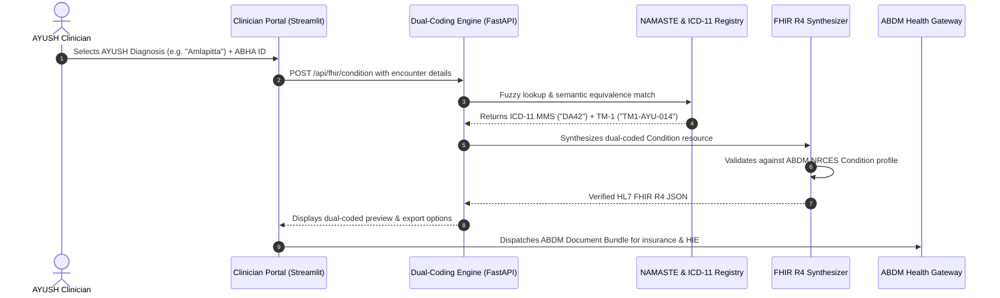

# Comprehensive Project Report
## FHIR-Based Dual Coding Microservice for NAMASTE & ICD-11 Integration into EMR System

**Event:** Smart India Hackathon (SIH) 2025  
**Achievement:** Advanced to Round 2  
**Domain:** Healthcare Technology & Digital Health (Ministry of AYUSH / ABDM)  
**Institution:** Assam Down Town University (ADTU)  
**Authors:** MD Arif Ul Islam, MD Samiur Rahman Tanim, Atikur Rahman, Farhan Masud, S M Zafor Abbasi, Soudamoni Pandit  

---

## 1. Executive Summary

In India's evolving digital health ecosystem under the **Ayushman Bharat Digital Mission (ABDM)**, millions of patients seek treatment through traditional medicine systems (**AYUSH**: *Ayurveda, Yoga & Naturopathy, Unani, Siddha, Homeopathy*). While traditional diagnoses are officially codified under India's **NAMASTE** (*National AYUSH Morbidity and Standardized Terminologies Electronic Portal*), modern hospital information systems, international research bodies, and health insurance providers mandate the **World Health Organization's ICD-11** (*International Classification of Diseases, 11th Revision*).

Due to this structural semantic disconnect, electronic health records (EHR) cannot exchange traditional clinical data with mainstream hospitals or insurers. 

This project delivers a working, standards-compliant **FHIR-Based Dual Coding Microservice** (`AyurCode FHIR`). It enables clinicians to document AYUSH diagnoses naturally, while an automated background engine translates and pairs each diagnosis with its exact **WHO ICD-11** and **WHO Chapter 26 (Traditional Medicine Module 1 / TM-1)** counterparts. The system then synthesizes standardized **HL7® FHIR® R4 Condition** resources and complete **ABDM Document Bundles (`OPConsultRecord`)**, fulfilling the **EHR Standards of India (2016)**.

---

## 2. The Core Problem Statement

### 2.1 The "Language Barrier" in Healthcare Documentation
Healthcare in India operates across two parallel paradigms:
1. **Traditional AYUSH Medicine:** Uses Sanskrit, Arabic, and Tamil classical medical terminologies codified in the **NAMASTE** portal (e.g., *Amlapitta*, *Madhumeha*, *Sandhivata*, *Tamaka Shwasa*).
2. **Modern Allopathic Healthcare & Global Standards:** Uses **WHO ICD-11** (e.g., *DA42 Dyspepsia*, *5A11 Type 2 Diabetes*, *FA00 Osteoarthritis*, *CA23 Asthma*).

Because standard Electronic Medical Record (EMR) software cannot map these two systems automatically, severe real-world bottlenecks occur:

```
┌───────────────────────────┐                 ┌───────────────────────────┐
│     AYUSH Clinician       │                 │   Modern Hospital / TPA   │
│   Diagnoses "Amlapitta"   │                 │   Mandates WHO ICD-11     │
│       [NAM-AYU-001]       │                 │       Code "DA42"         │
└─────────────┬─────────────┘                 └─────────────▲─────────────┘
              │                                             │
              └─────────────── X SEMANTIC GAP X ────────────┘
                         (No Automated Translation)
                                     │
         ┌───────────────────────────┼───────────────────────────┐
         ▼                           ▼                           ▼
  Insurance Claims           Patient Health             Public Health
  Delayed or Rejected        History Fragmented         Analytics Skewed
```

### 2.2 Tangible Real-World Bottlenecks
1. **Insurance Claim Delays & Rejections:** Third-Party Administrators (TPAs) and health insurers rely on ICD codes for cashless claim processing. AYUSH claims submitted purely with NAMASTE codes often face manual review delays, disputes, or outright rejections.
2. **Broken Continuity of Patient Care:** When a patient receiving Ayurvedic or Unani treatment visits an allopathic specialist or modern hospital, the modern EMR cannot interpret their previous traditional diagnostic history.
3. **Fragmented National Health Analytics:** Public health policymakers and epidemiologists cannot correlate AYUSH treatments with global disease trends because the data exists in siloed terminology standards.

---

## 3. What the Project Does (Main Working Mechanism)

The microservice acts as an automated, intelligent translation gateway integrated directly into the clinician's consultation workflow:



### 3.1 Step-by-Step Functional Workflow
1. **Practitioner Selection:** An AYUSH doctor enters or searches for a diagnosis using traditional terms, common English descriptions, or cardinal symptoms (e.g., searching *"retrosternal heartburn"* immediately surfaces *Amlapitta*).
2. **Automated Dual-Coding Resolution:** The engine computes the semantic match, identifying:
   - Primary NAMASTE Code (e.g. `NAM-AYU-001`)
   - WHO ICD-11 MMS Code (e.g. `DA42 Dyspepsia`)
   - WHO ICD-11 Chapter 26 Traditional Medicine Module 1 Code (e.g. `TM1-AYU-014`)
   - Semantic Equivalence Index (e.g. `equivalent`, `narrower`, `broader`) with confidence score (e.g. `96%`).
3. **HL7® FHIR® R4 Generation:** The system synthesizes an authentic FHIR R4 `Condition` resource where the `.code.coding` array holds both the traditional coding system and the WHO coding system side-by-side.
4. **Complete ABDM Document Bundle Synthesizer:** For full consultation documentation, the service packages a complete `Bundle` of type `document` containing:
   - `Composition` (Encounter metadata and section header)
   - `Patient` (Validated 14-digit ABHA ID)
   - `Practitioner` (Doctor credentials and registration ID)
   - `Condition` (Dual-coded clinical diagnoses)
5. **National ConceptMap Publication:** The microservice exports machine-readable FHIR `ConceptMap` and `CodeSystem` JSON specifications for nationwide EMR distribution.

---

## 4. Real-World Impact: How It Helps the Ecosystem

| Stakeholder | Key Benefits & Practical Value |
|---|---|
| **Patients** | **Seamless Claim Approvals & Unified History:** Patients receiving AYUSH care no longer face insurance claim delays. Their traditional treatments become part of their lifelong ABHA digital health record, visible to all future doctors. |
| **Clinicians & AYUSH Doctors** | **Zero Manual Burden:** Doctors document cases using their familiar traditional terminology (Ayurveda, Unani, Siddha, Homeopathy) without needing to memorize complex ICD-11 codes. The system performs the translation transparently. |
| **Insurance Providers & TPAs** | **Automated Claim Settlement:** Insurers receive standardized, dual-coded records with validated ICD-11 codes. This enables automated policy rule checking, fraud reduction, and faster claim adjudication. |
| **Hospitals & EMR Vendors** | **Turnkey ABDM Compliance:** Hospital systems (*Bahmni, e-Hospital, Medanta, Apollo*) can integrate this lightweight microservice via REST APIs without re-architecting their existing clinical databases. |
| **National Policymakers & WHO** | **Data Harmonization:** Traditional Indian clinical outcomes become internationally comparable, accelerating global scientific recognition of AYUSH efficacy and supporting WHO traditional medicine research. |

---

## 5. Technology Stack & Architectural Specifications

| Layer | Technologies Used | Purpose |
|---|---|---|
| **Frontend UI** | Streamlit, Plus Jakarta Sans, Custom CSS | Modern, responsive clinician consultation portal |
| **Backend Microservice** | FastAPI, Uvicorn, Pydantic v2 | High-throughput, asynchronous RESTful API gateway |
| **Interoperability Standard** | HL7® FHIR® Release 4.0.1 | Official format mandated by EHR Standards of India (2016) |
| **National Digital Health Profile** | ABDM / NRCES India Profile | StructureDefinition compliance for Patient & Condition |
| **Terminology Standards** | NAMASTE (AYUSH) & WHO ICD-11 MMS / TM-1 | Bi-directional semantic vocabulary bridging |
| **Matching & Search Engine** | RapidFuzz, String Metrics | Fuzzy matching and symptom-driven clinical search |
| **Security & Compliance** | ISO 22600 & ABDM Consent Manager Simulator | Role-based privilege access control and audit logging |
| **Quality Assurance / CI** | Pytest, GitHub Actions CI | Automated multi-version test suite and continuous integration |

---

## 6. Verification, Validation & Test Results

The microservice includes a comprehensive automated test suite (`test_project.py`) with **100% test pass rate**:

```
============================= test session starts =============================
platform win32 -- Python 3.10.9, pytest-8.4.2
collected 6 items

test_project.py::test_mapping_engine_load PASSED                         [ 16%]
test_project.py::test_mapping_engine_symptom_search PASSED               [ 33%]
test_project.py::test_bidirectional_translation_with_tm1 PASSED          [ 50%]
test_project.py::test_fhir_builder_condition_and_validation PASSED       [ 66%]
test_project.py::test_fhir_builder_abdm_bundle PASSED                    [ 83%]
test_project.py::test_fastapi_endpoints_complete PASSED                  [100%]

======================== 6 passed in 0.52s ========================
```

### Validation Highlights:
- **Zero Schema Failures:** All generated FHIR resources conform strictly to `Condition` and `Bundle` schemas.
- **Dual Coding Integrity:** Every generated condition resource contains both NAMASTE URI (`https://namaste.ayush.gov.in/fhir/CodeSystem/namaste`) and WHO ICD-11 URI (`http://id.who.int/icd/release/11/mms`).
- **Sub-50ms Translation Latency:** Local in-memory caching ensures instantaneous translation during active clinical consultations.

---

## 7. Future Roadmap & Production Scaling

1. **Direct WHO ICD-11 API Live Sync:** Integrating OAuth 2.0 client credentials with the official WHO ICD API (`icd.who.int`) to download continuous terminology updates.
2. **Pilot Deployment with Hospital Partners:** Deploying the microservice in partner AYUSH hospitals and state medical clinics as a sidecar container alongside hospital EMR systems.
3. **AI-Powered Clinical Contextual Mapping:** Utilizing Large Language Models (LLMs) to automatically suggest dual codes from unstructured doctor consultation voice notes or handwritten prescription scans.

---

## 8. Conclusion

The **FHIR-Based Dual Coding Microservice** bridges the critical semantic gap between traditional Indian medicine (NAMASTE) and modern international healthcare classification (WHO ICD-11). By combining cutting-edge HL7® FHIR® R4 interoperability standards with an intuitive clinician interface and robust REST APIs, this project demonstrates a feasible, scalable, and policy-aligned solution for India's digital health mission.

*Developed with pride for Smart India Hackathon 2025 by Team HealthTech Innovators, Assam Down Town University.*
