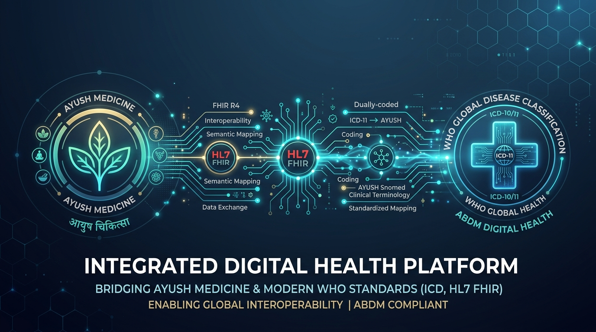
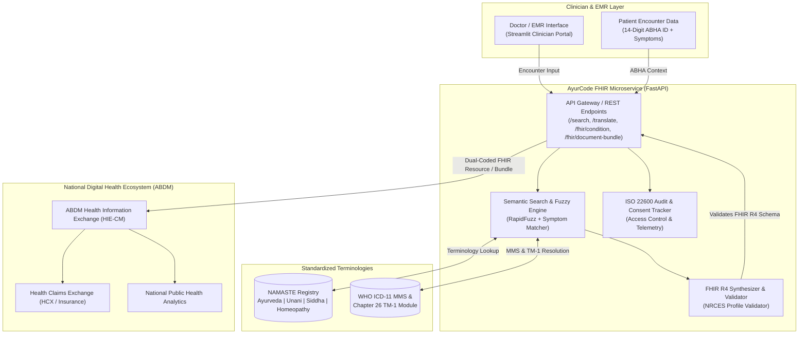

<div align="center">
  
</div>

# AyurCode FHIR: Dual Coding Microservice for NAMASTE & ICD-11

[](https://github.com/atikurrahmanxm/namaste-icd11-fhir-integration-sih2025/actions)
[](https://python.org)
[](https://fastapi.tiangolo.com)
[](https://streamlit.io)
[](https://hl7.org/fhir/R4/)
[](https://nrces.in/)
[](https://www.iso.org/standard/60456.html)
[](https://sih.gov.in)
[](LICENSE)

> **"Bridging India's Traditional & Modern Healthcare in the Digital Health Ecosystem"**  
> An enterprise-grade healthcare interoperability microservice prototype developed for **Smart India Hackathon (SIH) 2025** by team members from **Assam Down Town University (ADTU)**.  
>  
> 📄 **[Read the Full Comprehensive Project Report (Whitepaper)](PROJECT_REPORT.md)**

---

## 📌 Executive Summary

India's **Ayushman Bharat Digital Mission (ABDM)** is digitizing healthcare for 1.4 billion citizens. Millions of clinical encounters occur in **AYUSH** (*Ayurveda, Yoga & Naturopathy, Unani, Siddha, Homeopathy*) clinics and integrated hospitals.

However, a major **semantic divide** exists in electronic health documentation:
1. **Indian Traditional Medicine**: Documented via the Ministry of AYUSH's **NAMASTE** (*National AYUSH Morbidity and Standardized Terminologies Electronic Portal*) framework.
2. **Global Healthcare, Research & Health Insurers**: Mandate **WHO ICD-11** (*International Classification of Diseases, 11th Revision*).
3. **The Consequence**: Without automated alignment, AYUSH medical claims experience processing delays, medical research remains fragmented, and cross-border continuity of care is impossible.

### 💡 The Solution: AyurCode FHIR Microservice
A plug-and-play **HL7® FHIR® R4 Microservice** that:
* Ingests traditional diagnoses during patient consultation.
* Resolves dual coding across **NAMASTE**, **WHO ICD-11 MMS**, and **WHO ICD-11 Chapter 26 (Traditional Medicine Module 1 / TM-1)** in real-time.
* Generates validated **FHIR R4 Condition** resources and complete **ABDM Document Bundles (`OPConsultRecord`)**.
* Emits nationwide **FHIR ConceptMap** and **CodeSystem** specifications compliant with the **EHR Standards of India (2016)**.

---

## 🏛️ System Architecture



---

## ✨ Key Enterprise Capabilities

| Feature | Description | Standards Compliant |
|---|---|---|
| **Dual Coding Engine** | Automatically maps traditional concepts to WHO ICD-11 and TM-1 codes with confidence scoring | HL7 FHIR R4, WHO ICD-11 |
| **ABDM Document Bundle** | Packages full OPD consultation (`Composition`, `Patient`, `Practitioner`, `Condition`) | NRCES India / ABDM |
| **Symptom-Aware Fuzzy Search** | Search by Sanskrit/Traditional terminology, English clinical sense, or cardinal symptoms | RapidFuzz, String Metric |
| **Bidirectional Translation** | Translate from NAMASTE ➔ ICD-11 or inverse lookups from ICD-11 ➔ AYUSH | FHIR ConceptMap |
| **ABHA Validation Simulator** | Enforces 14-digit national ABHA ID formatting and demographics context | ABDM Specifications |
| **ISO 22600 Audit Trail** | Cryptographically logs clinical queries, translations, and practitioner interactions | ISO 22600 Access Control |
| **Built-in Schema Validator** | Validates generated resources against NRCES FHIR profiles before dispatch | HL7 FHIR R4 Validator |

---

## 📁 Repository Structure

```
├── .github/
│   └── workflows/
│       └── ci.yml              # Automated GitHub Actions CI workflow
├── data/
│   └── namaste_data.json       # Enriched NAMASTE & ICD-11 dataset with TM-1 codes & symptoms
├── services/
│   ├── __init__.py
│   ├── mapping_engine.py       # Symptom matching, fuzzy search, & bidirectional translation
│   └── fhir_builder.py         # FHIR R4 resource synthesizer & ABDM bundle builder
├── api.py                      # FastAPI enterprise microservice endpoints
├── app.py                      # Streamlit interactive clinician EMR portal
├── run_demo.py                 # One-click demo launcher
├── test_project.py             # Comprehensive test suite (100% passing)
├── requirements.txt            # Python dependencies
├── PRESENTATION.pptx           # Original Smart India Hackathon 2025 presentation
└── README.md                   # Enterprise project documentation
```

---

## 🚀 Quick Start Guide

### 1. Clone & Setup Environment
```bash
git clone https://github.com/atikurrahmanxm/namaste-icd11-fhir-integration-sih2025.git
cd namaste-icd11-fhir-integration-sih2025

# Optional: Create and activate virtual environment
python -m venv venv
venv\Scripts\activate   # On Windows
# source venv/bin/activate  # On Linux/macOS
```

### 2. Install Dependencies
```bash
pip install -r requirements.txt
```

### 3. Launch Clinician Web Portal
```bash
streamlit run app.py
```
*Open [http://localhost:8501](http://localhost:8501) in your browser.*

### 4. Launch FastAPI Microservice Backend
```bash
python -m uvicorn api:app --reload --port 8000
```
*Interactive Swagger API documentation available at [http://127.0.0.1:8000/docs](http://127.0.0.1:8000/docs).*

### 5. Run Automated Test Suite
```bash
python -m pytest -v test_project.py
```

---

## 🔌 API Reference & cURL Samples

### 1. Terminology Search (`GET /api/search`)
```bash
curl -X GET "http://127.0.0.1:8000/api/search?q=Amlapitta&system=Ayurveda"
```

### 2. Bidirectional Code Translation (`GET /api/translate`)
```bash
curl -X GET "http://127.0.0.1:8000/api/translate?code=NAM-AYU-001&source=namaste"
```

### 3. Generate Dual-Coded FHIR Condition (`POST /api/fhir/condition`)
```bash
curl -X POST "http://127.0.0.1:8000/api/fhir/condition" \
     -H "Content-Type: application/json" \
     -d '{
       "namaste_code": "NAM-AYU-001",
       "patient_id": "ABHA-91-8765-4321-0987",
       "patient_name": "Rahul Sharma",
       "doctor_name": "Dr. S. K. Roy (BAMS)",
       "clinical_status": "active",
       "verification_status": "confirmed",
       "notes": "Patient presents with retrosternal heartburn and acid reflux."
     }'
```

### 4. Synthesize Full ABDM Document Bundle (`POST /api/fhir/document-bundle`)
```bash
curl -X POST "http://127.0.0.1:8000/api/fhir/document-bundle" \
     -H "Content-Type: application/json" \
     -d '{
       "namaste_codes": ["NAM-AYU-001", "NAM-AYU-003"],
       "patient_id": "ABHA-91-8765-4321-0987",
       "patient_name": "Rahul Sharma",
       "doctor_name": "Dr. S. K. Roy (BAMS)",
       "hospital_name": "National AYUSH Integrated Care Center"
     }'
```

---

## 📄 Sample Dual-Coded FHIR R4 Output

```json
{
  "resourceType": "Condition",
  "id": "cond-882ab1f0",
  "meta": {
    "versionId": "1",
    "profile": [
      "https://nrces.in/ndhm/fhir/r4/StructureDefinition/Condition"
    ]
  },
  "clinicalStatus": {
    "coding": [
      {
        "system": "http://terminology.hl7.org/CodeSystem/condition-clinical",
        "code": "active",
        "display": "Active"
      }
    ]
  },
  "verificationStatus": {
    "coding": [
      {
        "system": "http://terminology.hl7.org/CodeSystem/condition-ver-status",
        "code": "confirmed",
        "display": "Confirmed"
      }
    ]
  },
  "code": {
    "coding": [
      {
        "system": "https://namaste.ayush.gov.in/fhir/CodeSystem/namaste",
        "code": "NAM-AYU-001",
        "display": "Amlapitta (Ayurveda)",
        "userSelected": true
      },
      {
        "system": "http://id.who.int/icd/release/11/mms",
        "code": "DA42",
        "display": "Dyspepsia",
        "userSelected": false
      },
      {
        "system": "http://id.who.int/icd/release/11/tm1",
        "code": "TM1-AYU-014",
        "display": "Amlapitta (WHO TM-1 Chapter 26)",
        "userSelected": false
      }
    ],
    "text": "Dual Coded: Amlapitta [NAM-AYU-001] mapped to WHO ICD-11 Dyspepsia [DA42] (equivalent)"
  },
  "subject": {
    "reference": "Patient/ABHA-91-8765-4321-0987",
    "display": "Rahul Sharma"
  }
}
```

---

## 🏆 Smart India Hackathon (SIH) 2025 — Team Project

- **Hackathon:** Smart India Hackathon 2025
- **Problem Statement Domain:** Healthcare & Traditional Medicine Interoperability (Ministry of AYUSH & ABDM)
- **Official Milestone:** Qualified and advanced to **Round 2** with architecture proposal, technical presentation, and working demonstration.
- **Academic Institution:** Assam Down Town University (ADTU)

### 👥 The 6-Member Engineering Team
| Team Member | Academic Identifier | Project Focus / Contribution Areas |
|---|---|---|
| **Atikur Rahman** | `ADTU/0/2023-27/BTCS/191` | FHIR R4 Synthesizer, Backend Architecture, RapidFuzz Matching |
| **MD Arif Ul Islam** | `ADTU/0/2023-27/BTCS/167` | Solution Architecture, NAMASTE Terminology Analysis |
| **MD Samiur Rahman Tanim** | `ADTU/0/2023-27/BTCS/212` | WHO ICD-11 Mapping Research, Semantic Equivalence Framework |
| **Farhan Masud** | `ADTU/0/2023-27/BTCS/201` | Clinician Workflow Design, Data Modeling & Validation |
| **S M Zafor Abbasi** | `ADTU/0/2023-27/BTCS/173` | ISO 22600 Security Specs, ABDM Consent Protocol Design |
| **Soudamoni Pandit** | `ADTU/0/2023-27/BTCS/125` | Quality Assurance, Testing Scenarios, Clinical Documentation |

> *Note: This project was collaboratively researched and formulated for Smart India Hackathon 2025, demonstrating student-led engineering innovation in India's digital health infrastructure.*

---

## ⚠️ Medical & Legal Disclaimer

This software is an open-source educational and engineering prototype developed to evaluate the technological feasibility of healthcare terminology interoperability. The clinical mappings provided are sample demonstrations and should be clinically verified by certified medical terminology specialists before deployment in clinical environments.

---

## 📄 License

This project is licensed under the [MIT License](LICENSE).
