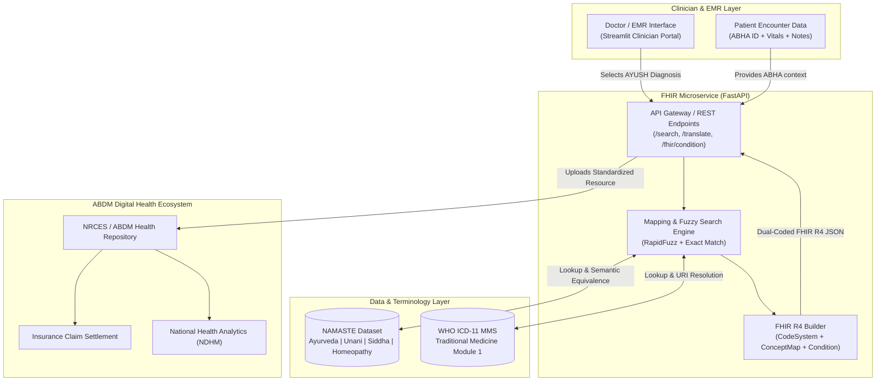

# FHIR-Based Dual Coding Microservice for NAMASTE & ICD-11 Integration into EMR System

[](https://python.org)
[](https://fastapi.tiangolo.com)
[](https://streamlit.io)
[](https://hl7.org/fhir/R4/)
[](https://nrces.in/)
[](https://sih.gov.in)
[](LICENSE)

> **"Bridging Traditional & Modern Healthcare in India's Digital Health Ecosystem"**  
> Developed as a prototype for **Smart India Hackathon (SIH) 2025** by team members from **Assam Down Town University (ADTU)**.

---

## 📌 Executive Summary & Background

India's **Ayushman Bharat Digital Mission (ABDM)** is transforming healthcare delivery into an interoperable, patient-centric digital network. Millions of patients actively consult traditional medicine practitioners across **AYUSH** (*Ayurveda, Yoga & Naturopathy, Unani, Siddha, Homeopathy*).

However, a critical semantic divide exists:
1. **Traditional Diagnoses** are documented using the Indian Ministry of AYUSH's **NAMASTE** (*National AYUSH Morbidity and Standardized Terminologies Electronic Portal*) framework.
2. **Global EMRs, Insurers, & Policy Makers** mandate the **WHO ICD-11** (*International Classification of Diseases, 11th Revision*).
3. **The Consequence**: Without automated alignment, AYUSH claims suffer processing delays, health records cannot be cross-referenced internationally, and public health analytics remain fractured.

### 💡 The Solution
This project introduces a **FHIR-based Dual Coding Microservice**. When a clinician records an AYUSH diagnosis in an Electronic Medical Record (EMR), this service automatically maps it to its corresponding WHO ICD-11 counterpart and synthesizes a dual-coded **HL7® FHIR® R4 Condition** resource compliant with the **EHR Standards of India (2016)**.

---

## 🏛️ System Architecture



---

## ✨ Key Features

1. **Intelligent Autocomplete & Fuzzy Search**:
   - Real-time search across NAMASTE codes, Sanskrit/traditional terms, and English clinical descriptions.
   - Filterable across Ayurveda, Unani, Siddha, and Homeopathy.

2. **Bidirectional Semantic Translation**:
   - `NAMASTE → WHO ICD-11`: Translates traditional diagnoses into global ICD-11 entities with confidence scoring and semantic equivalence (`equivalent`, `narrower`, `broader`).
   - `WHO ICD-11 → NAMASTE`: Inverse resolution for cross-referencing allopathic diagnoses with traditional counterparts.

3. **Standards-Compliant HL7 FHIR R4 Generation**:
   - Emits dual-coded `Condition` resources containing parallel coding arrays:
     - `system`: `https://namaste.ayush.gov.in/fhir/CodeSystem/namaste`
     - `system`: `http://id.who.int/icd/release/11/mms`
   - Bundles multi-diagnosis consultations into valid FHIR R4 `Bundle` collections (ProblemList).

4. **FHIR ConceptMap & CodeSystem Exporter**:
   - Complete export of the terminology mappings as an HL7 FHIR R4 `ConceptMap` resource for nationwide distribution.

5. **ABHA (Ayushman Bharat Health Account) Simulator**:
   - Ingests 14-digit ABHA numbers and patient identifiers into the `Condition.subject` field.

---

## 📁 Repository Structure

```
├── data/
│   └── namaste_data.json       # Curated NAMASTE & ICD-11 terminology dataset
├── services/
│   ├── __init__.py
│   ├── mapping_engine.py       # Search, fuzzy matching, & bidirectional lookup
│   └── fhir_builder.py         # HL7 FHIR R4 resource generators
├── api.py                      # FastAPI microservice REST API endpoints
├── app.py                      # Streamlit interactive clinician portal
├── run_demo.py                 # One-click demo launcher
├── test_project.py             # Pytest test suite (100% passing)
├── requirements.txt            # Python dependencies
├── PRESENTATION.pptx           # Original Smart India Hackathon 2025 presentation
└── README.md                   # Project documentation
```

---

## 🚀 Quick Start Guide

### 1. Prerequisites
- Python 3.10 or higher
- Git

### 2. Clone the Repository
```bash
git clone https://github.com/<your-username>/namaste-icd11-fhir-integration.git
cd namaste-icd11-fhir-integration
```

### 3. Install Dependencies
```bash
pip install -r requirements.txt
```

### 4. Run the Clinician Portal (Web UI)
```bash
streamlit run app.py
```
*Open [http://localhost:8501](http://localhost:8501) in your browser.*

### 5. Run the FastAPI Microservice (Optional Backend Mode)
```bash
python -m uvicorn api:app --reload --port 8000
```
*Access interactive Swagger API documentation at [http://127.0.0.1:8000/docs](http://127.0.0.1:8000/docs).*

### 6. Run Test Suite
```bash
python -m pytest -v test_project.py
```

---

## 🔌 REST API Reference

| Endpoint | Method | Description |
|---|---|---|
| `/health` | `GET` | Health check probe |
| `/api/stats` | `GET` | Terminology counts and coverage statistics |
| `/api/search` | `GET` | Search diagnoses by query and system filter |
| `/api/translate` | `GET` | Bidirectional code translator (`source=namaste` or `source=icd11`) |
| `/api/fhir/condition` | `POST` | Generate dual-coded HL7 FHIR R4 Condition resource |
| `/api/fhir/conceptmap` | `GET` | Export full FHIR R4 ConceptMap specification |
| `/api/fhir/codesystem` | `GET` | Export full FHIR R4 CodeSystem specification |

### Sample POST `/api/fhir/condition` Payload
```json
{
  "namaste_code": "NAM-AYU-001",
  "patient_id": "ABHA-91-8765-4321-0987",
  "patient_name": "Rahul Sharma",
  "doctor_name": "Dr. S. K. Roy (BAMS)",
  "clinical_status": "active",
  "verification_status": "confirmed",
  "notes": "Patient presents with retrosternal burning and postprandial acidity."
}
```

### Generated Dual-Coded FHIR R4 Resource (Excerpt)
```json
{
  "resourceType": "Condition",
  "id": "cond-a8f3b21c",
  "meta": {
    "profile": ["https://nrces.in/ndhm/fhir/r4/StructureDefinition/Condition"]
  },
  "code": {
    "coding": [
      {
        "system": "https://namaste.ayush.gov.in/fhir/CodeSystem/namaste",
        "code": "NAM-AYU-001",
        "display": "Amlapitta (Ayurveda)",
        "userSelected": true
      },
      {
        "system": "http://id.who.int/icd/release/11/mms",
        "code": "DA42",
        "display": "Dyspepsia",
        "userSelected": false
      }
    ],
    "text": "Dual Coded: Amlapitta [NAM-AYU-001] mapped to WHO ICD-11 Dyspepsia [DA42] (equivalent)"
  },
  "subject": {
    "reference": "Patient/ABHA-91-8765-4321-0987",
    "display": "Rahul Sharma"
  }
}
```

---

## 🏆 Smart India Hackathon (SIH) 2025 Participation

- **Competition**: Smart India Hackathon 2025
- **Category**: Healthcare & Digital Health / Ministry of AYUSH
- **Milestone**: Advanced to **Round 2** with team presentation and architecture design.
- **Team Members (Assam Down Town University)**:
  - **MD Arif Ul Islam**
  - **MD Samiur Rahman Tanim**
  - **Atikur Rahman**
  - **Farhan Masud**
  - **S M Zafor Abbasi**
  - **Soudamoni Pandit**

---

## ⚠️ Disclaimer

This software is an open-source research and educational prototype developed to evaluate the technological feasibility of healthcare terminology interoperability. The clinical mappings provided are sample demonstrations and should be clinically verified by certified medical terminology specialists before deployment in clinical environments.

---

## 📄 License

This project is licensed under the [MIT License](LICENSE).
